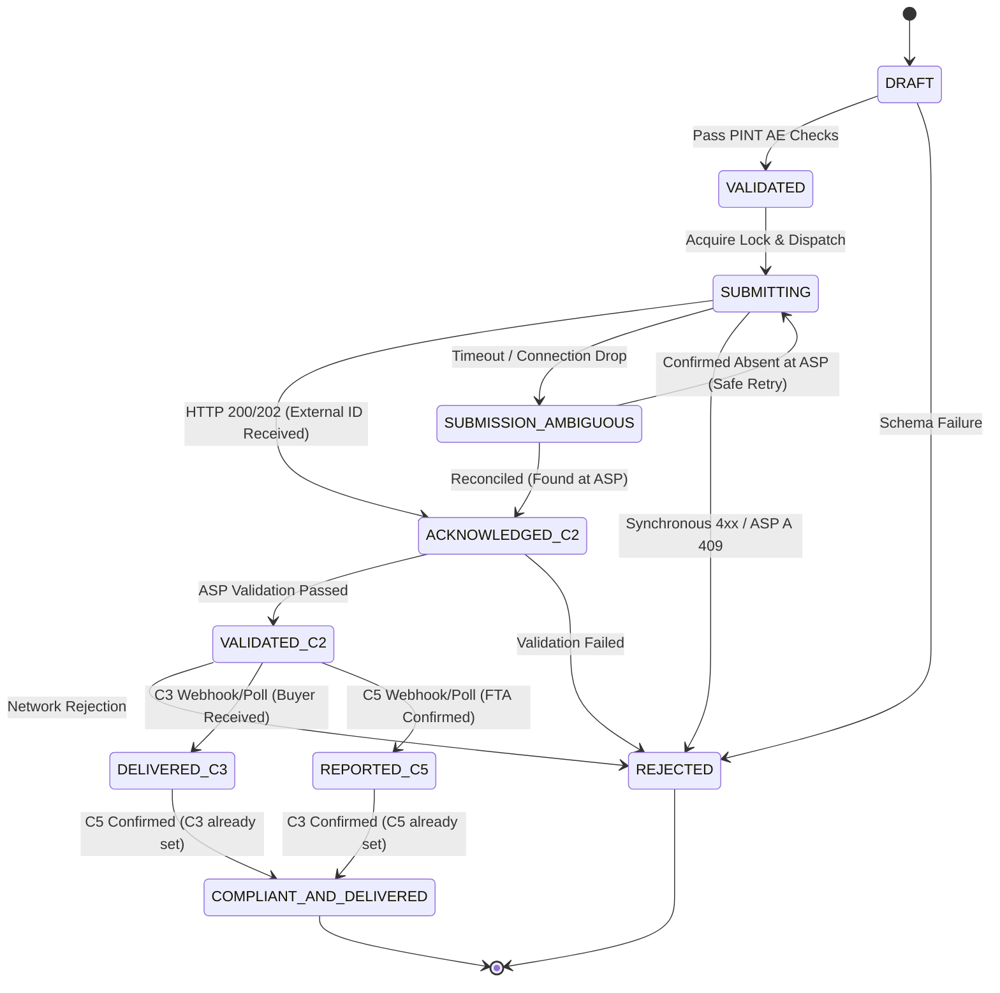

# Finkraft B2B E-Invoicing Platform: Architecture Design Note
**Author:** CTO Candidate | **Scope:** Part 1 – Multi-ASP Architecture, State Machine & Failure Resilience | **Target:** UAE FTA Mandate

---

## 1. Business Context & Explicit Assumptions

Under the UAE Federal Tax Authority (FTA) mandate, e-invoicing is a legal requirement governed by a **Decentralized Continuous Transaction Control and Exchange (DCTCE) 5-Corner Model**:
* **Corner 1 (C1):** Seller (Finkraft’s enterprise customer generating invoice data).
* **Corner 2 (C2):** Seller’s Accredited Service Provider (ASP) that validates and transmits invoices.
* **Corner 3 (C3):** Buyer’s ASP that receives electronic invoices over the Peppol network.
* **Corner 4 (C4):** Buyer who receives compliant invoice data into their ERP.
* **Corner 5 (C5):** UAE Federal Tax Authority (FTA) receiving the Tax Data Document (TDD).

```
   [ C1: Seller ]  ---> [ Finkraft Engine ] ---> [ C2: Seller's ASP ]
                                                        |
                            +---------------------------+---------------------------+
                            |                                                       |
                            v                                                       v
                   [ C3: Buyer's ASP ]                                     [ C5: UAE FTA ]
                            |                                               (Tax Clearance)
                            v
                   [ C4: Buyer ERP ]
```

### Business Stakes
Invoice records represent sovereign tax documents. Errors, duplicate submissions, or lost records lead to direct financial penalties from the FTA, frozen VAT input credits for buyers, and customer churn. Finkraft must guarantee **100% data integrity, zero lost invoices, and zero duplicate submissions**.

### Explicit Assumptions
1. **Business Key Uniqueness:** The compound key `(seller_trn, invoice_number)` is globally unique and immutable across the platform lifecycle.
2. **Pre-Submission Enrichment:** Finkraft validates and enriches raw customer feeds into compliant **PINT AE UBL 2.1 XML** before calling any ASP. Syntax and business-rule errors (e.g., missing 15-digit TRN, VAT code BT-48) are rejected internally to protect ASP quotas and reputation.
3. **ASP A Profile:** Synchronous submission (`POST /invoices`), status polling (`GET /invoices/{id}`), rate limit of 10 requests/sec. Native idempotency rejects duplicate invoice numbers with HTTP 409. Network timeouts occasionally occur *after* ASP A has accepted the invoice.
4. **ASP B Profile:** Asynchronous submission (`POST /v2/submissions` $\to$ HTTP 202 with `job_id`), webhook callbacks only (no query endpoint). **Zero duplicate checking** (submitting twice creates duplicate tax filings at the FTA). Webhooks can arrive late, duplicated, or out-of-order.
5. **ASP Switching Semantics:** Customers can change or add ASPs via configuration. In-flight invoices retain their originating ASP adapter until reaching a terminal state. New submissions route to the newly selected ASP.
6. **Webhook Authenticity:** Inbound webhooks from ASP B are signed via HMAC-SHA256 headers (`X-ASP-Signature`) and carry an immutable `event_id`.

---

## 2. Unified Adapter Contract & Dynamic ASP Switching

To shield core business logic from ASP idiosyncrasies, Finkraft employs an **Adapter Pattern** orchestrated via an **ASP Registry**. Customers can switch or add ASPs without core code modifications.

```
                           +---------------------------+
                           |       <<Contract>>        |
                           |        ASP Adapter        |
                           +---------------------------+
                           | - submit_invoice()        |
                           | - poll_status()           |
                           | - parse_webhook()         |
                           | - get_capabilities()      |
                           +---------------------------+
                                         ^
                     +-------------------+-------------------+
                     |                                       |
        +-------------------------+             +-------------------------+
        |       ASP A Adapter     |             |       ASP B Adapter     |
        +-------------------------+             +-------------------------+
        | - Rate Limiter (10 rps) |             | - HMAC Signature Verif  |
        | - Sync Submit + Polling |             | - Async Submit (202)    |
        | - Timeout Reconciler    |             | - Webhook Normalizer    |
        +-------------------------+             +-------------------------+
```

### Standardized Methods & Capabilities

| Method | Input | Output | Business Purpose |
|---|---|---|---|
| `submit_invoice` | `CanonicalInvoice` (PINT AE payload, metadata) | `SubmissionResult` | Dispatches invoice to ASP; normalizes synchronous responses (ASP A) and asynchronous job receipts (ASP B). |
| `poll_status` | `external_id` (ASP submission/job ID) | `StatusUpdate` | Actively checks status for polling-based ASPs (ASP A). Raises `NotSupported` for webhook-only ASPs. |
| `parse_webhook` | HTTP Headers, JSON Payload | `StatusUpdate` | Verifies webhook cryptographic signature, deduplicates event ID, and translates ASP B events into standard status updates. |
| `get_capabilities` | *None* | `ASPCapabilities` | Exposes operational metadata (sync/async, polling support, rate limits, native idempotency) to configure routing and rate limiters. |

### Standardized Data Models (Conceptual Summary)
* **`CanonicalInvoice`**: Standardized business invoice containing seller TRN, buyer TRN, invoice number, issue date, monetary totals, and validated PINT AE XML.
* **`SubmissionResult`**: Encapsulates submission success, ambiguous timeout indicators, ASP-assigned reference ID, normalized initial status, and standardized errors.
* **`StatusUpdate`**: Uniform status payload containing ASP reference ID, normalized milestone status, timestamp, and error details.
* **`NormalizedError`**: Standardized error schema (`code`, `message`, `field_reference`, `is_transient`) translating vendor codes (e.g., ASP A `{"code": "E104", "field": "BT-48"}` or ASP B `{"rule": "...", "message": "..."}`).

*(Full typed Python implementation contracts are maintained in `docs/TECHNICAL_CONTRACT_SPEC.md`.)*

---

## 3. Invoice State Machine & Normalization

Finkraft manages an internal state machine that decouples internal lifecycle management from ASP-specific statuses.

### Finkraft Internal States

| State | Category | Description |
|---|---|---|
| `DRAFT` | Initial | Ingested via customer bulk upload or ERP connector. |
| `VALIDATED` | Internal | Passed internal PINT AE validation and tax arithmetic. Ready for C2 dispatch. |
| `SUBMITTING` | Transient | Distributed lock acquired on `(seller_trn, invoice_number)`. In-flight to C2. |
| `SUBMISSION_AMBIGUOUS` | Incident | Network timeout or drop during submission. Awaiting active reconciliation. |
| `ACKNOWLEDGED_C2` | Processing | C2 accepted the payload (ASP A `RECEIVED`, ASP B `QUEUED` / `ACCEPTED`). |
| `VALIDATED_C2` | Processing | C2 verified Peppol schema and digital signature (ASP A `VALIDATED`). |
| `DELIVERED_C3` | Intermediate | Buyer’s ASP confirmed receipt. Awaiting C5 FTA clearance. |
| `REPORTED_C5` | Intermediate | FTA confirmed tax clearance. Awaiting C3 buyer delivery. |
| `COMPLIANT_AND_DELIVERED` | **Terminal Success** | **Both C3 Delivery and C5 FTA Clearance confirmed.** Immutable end state. |
| `REJECTED` | **Terminal Failure** | Validation or tax rule failure at C2, C3, or C5. Non-reversible. |

### Status Normalization Matrix

| ASP Status | Raw Value | Normalized Status | Finkraft Target State |
|---|---|---|---|
| **ASP A** | `RECEIVED` | `ACKNOWLEDGED` | `ACKNOWLEDGED_C2` |
| **ASP A** | `VALIDATED` | `VALIDATED` | `VALIDATED_C2` |
| **ASP A** | `DELIVERED` | `DELIVERED_C3` | `DELIVERED_C3` (or `COMPLIANT_AND_DELIVERED` if C5 met) |
| **ASP A** | `REPORTED` | `REPORTED_C5` | `REPORTED_C5` (or `COMPLIANT_AND_DELIVERED` if C3 met) |
| **ASP A** | `REJECTED` | `REJECTED` | `REJECTED` |
| **ASP B** | `QUEUED`, `ACCEPTED` | `ACKNOWLEDGED` | `ACKNOWLEDGED_C2` |
| **ASP B** | `BUYER_RECEIVED` | `DELIVERED_C3` | `DELIVERED_C3` (or `COMPLIANT_AND_DELIVERED` if C5 met) |
| **ASP B** | `TAX_CONFIRMED` | `REPORTED_C5` | `REPORTED_C5` (or `COMPLIANT_AND_DELIVERED` if C3 met) |
| **ASP B** | `FAILED` | `REJECTED` | `REJECTED` |

### State Transition Diagram & Monotonic Milestones



**Milestone Lattice Logic:** Every invoice maintains `c3_delivered_at` and `c5_reported_at` timestamps. The terminal state `COMPLIANT_AND_DELIVERED` is reached whichever order C3 and C5 arrive in. Out-of-order or duplicate events (e.g., an `ACCEPTED` webhook arriving after `REPORTED_C5`) are safely dropped as idempotent no-ops.

---

## 4. Failure Handling & Reliability Engineering

E-invoicing failure handling directly impacts corporate tax compliance and executive liability. The table and detailed workflows below describe how Finkraft prevents catastrophic compliance failures.

| Failure Mode | Root Cause / Trigger | Business Impact | Technical Mitigation Strategy |
|---|---|---|---|
| **Submission Timeout** | ASP A occasionally times out *after* accepting the invoice. Network drops on ASP B submit. | Naive retries create duplicate invoices or trigger false rejections, delaying commercial billing. | **State Isolation to `SUBMISSION_AMBIGUOUS` & Active Reconciliation:** Automatic retries are strictly blocked. Finkraft triggers a background reconciliation worker to query ASP A by invoice number. If found, external ID is attached and state advances to `ACKNOWLEDGED_C2`. Only if verified absent is a retry allowed. |
| **Duplicate Submission** | ASP B has **no duplicate checking**. Retrying a bulk upload duplicates invoices. | **Severe:** Filing duplicate tax documents with the FTA creates duplicate VAT liabilities, leading to tax audits and fines. | **Client-Side Pessimistic Idempotency Lock:** Database unique index on `(seller_trn, invoice_number)`. Atomic compare-and-swap transitions (`VALIDATED` $\to$ `SUBMITTING`). Any concurrent upload of an existing invoice is blocked before reaching the network. |
| **Late / Duplicate Webhooks** | ASP B redelivers webhooks hours later or out of sequence. | Outdated callbacks could revert an invoice from completed to in-progress, corrupting audit trails. | **Idempotent Webhook Event Ledger & Monotonic Guards:** Inbound webhooks log `(asp_id, event_id)` in an append-only ledger with a unique key. Redeliveries return HTTP 200 immediately. State machine enforces a monotonic lattice: backwards transitions are rejected. |
| **Out-of-Order Webhooks** | ASP B delivers `TAX_CONFIRMED` (C5) before `BUYER_RECEIVED` (C3). | Invoice could get stuck in intermediate state if the system expects a strict linear progression. | **Milestone-Based Accumulation:** Independent milestone flags (`c3_delivered_at`, `c5_reported_at`). The platform transitions to `COMPLIANT_AND_DELIVERED` as soon as both flags are non-null, regardless of sequence. |
| **ASP Rate Limiting (10 req/s)** | Customer bulk upload of 10,000 invoices overwhelms ASP A's quota. | HTTP 429 throttling errors, failed bulk uploads, and poor customer experience. | **Token Bucket Outbound Throttler:** Outbound dispatcher throttles traffic to 10 req/s per ASP A tenant. Overflow is buffered in persistent message queues with exponential jittered backoff. |

### Deep-Dive: Submission Timeout Reconciliation Protocol
1. Client initiates submission to ASP A $\to$ HTTP socket times out after 30 seconds.
2. Finkraft marks invoice as `SUBMISSION_AMBIGUOUS` and commits to DB (releasing lock).
3. Reconciliation Worker schedules an inquiry task with exponential backoff (10s, 30s, 60s).
4. Worker queries ASP A (`GET /invoices?reference={invoice_number}`).
   - **Case A (Found):** ASP A accepted the record prior to timeout. Extract `submission_id`, transition invoice directly to `ACKNOWLEDGED_C2`, and resume normal tracking.
   - **Case B (Not Found after 3 checks):** Record does not exist at ASP A. Mark safe to re-dispatch, transition back to `SUBMITTING`, and call `POST /invoices`.
   - **Case C (Persistent Error):** Escalate to Operations Alert Queue for human inspection. **Never blind-retry.**

---

## 5. Architectural Trade-offs & Strategic Decisions

### Decision 1: Asynchronous Unified Event-Driven Pipeline vs. Synchronous Passthrough
* **Context:** ASP A supports synchronous submissions with immediate responses, whereas ASP B is strictly asynchronous (`POST /v2/submissions` $\to$ HTTP 202). Finkraft could have exposed a dual API (synchronous for ASP A customers, asynchronous for ASP B).
* **Strategic Choice:** Finkraft enforces a **unified asynchronous ingestion pipeline** for all customers regardless of ASP. Bulk uploads and single invoices receive an immediate HTTP 202 acknowledgment with an internal tracking ID. Background workers handle ASP communication.
* **Business & Technical Gains:**
  - **Seamless ASP Portability:** Customers can switch from ASP A to ASP B with zero changes to their ERP integration or webhook ingestion.
  - **Rate Limit & Burst Protection:** Enterprise customers uploading thousands of invoices at month-end will not exhaust ASP A’s strict 10 req/s limit or cause gateway timeouts.
  - **Resilience Against ASP Outages:** Transient ASP downtime is absorbed by internal retry queues without failing the customer's batch upload.
* **What We Sacrificed:**
  - **Immediate Single-Invoice Feedback:** Interactive POS or retail systems cannot receive an immediate C2 confirmation within the same HTTP connection; they must query an endpoint or listen to Finkraft webhooks.

### Decision 2: Pessimistic Idempotency & Reconciliation State vs. Optimistic Fast Retries
* **Context:** ASP B has **zero duplicate detection**, meaning any duplicate submission directly creates duplicate tax documents at the UAE FTA. Furthermore, ASP A times out *after* accepting invoices.
* **Strategic Choice:** We implemented **pessimistic, database-enforced idempotency locks** and an explicit `SUBMISSION_AMBIGUOUS` quarantine state, strictly banning automated blind retries without prior reconciliation.
* **Business & Technical Gains:**
  - **Zero Duplicate Tax Filings:** Completely eliminates the catastrophic business risk of duplicate tax reporting to the UAE government, protecting customers from severe VAT penalties, audits, and inflated tax liabilities.
  - **Deterministic Audit Trail:** Every ambiguous state is logged and reconciled explicitly, providing a tamper-proof audit trail for tax authorities and enterprise compliance officers.
* **What We Sacrificed:**
  - **Throughput & Fast Auto-Recovery:** In the rare event of a network glitch, the invoice cannot instantly self-heal in a tight 1-second retry loop. It enters a reconciliation queue that may take 30–60 seconds to safely resolve.
  - **Write Contention:** Strict locking on `(seller_trn, invoice_number)` prevents parallel ingestion of multiple revisions of the same invoice, requiring ERPs to sequence updates.
